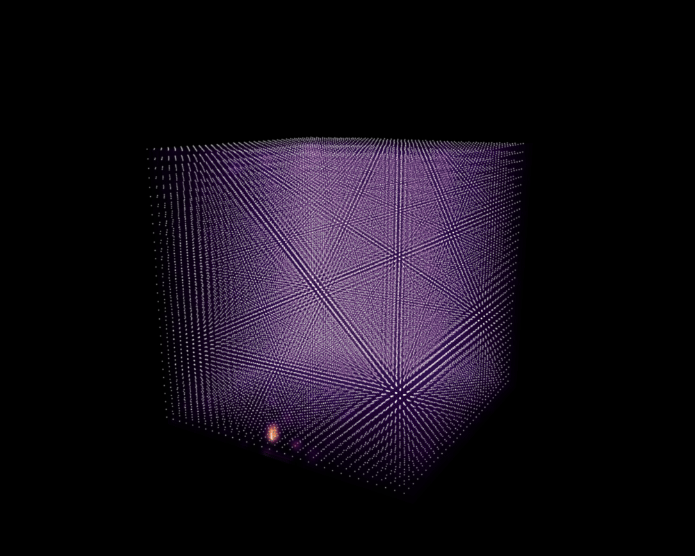

# Cosmological Code

This repository contains a TreePM/MFM cosmological C++ code, along with documentation that explains the underlying physics and algorithms.

## Key Features

* **Gravity Solvers:**
    * **TreePM Gravity:** Fourier-Split solver combining an FFT-based Particle-Mesh (PM) for long-range forces with a Linear Bounding Volume Hierarchy (LBVH) tree for short-range interactions.
* **Cosmology:**
    * **Integration:** Supports generalized flat $\Lambda\text{CDM}$ cosmologies (including Einstein-de Sitter) using a Kick-Drift-Kick (KDK) scheme.
    * **Initial Conditions:** Includes native generation of initial conditions for cosmological simulations (via the Zel'dovich Approximation and the BBKS transfer function) and a set of typical tests.
* **Hydrodynamics:**
    * **MFM Solver:** Implements a Lagrangian **Meshless Finite Mass (MFM)** particle-based solver.
    * **HLLC and exact Riemann Solvers:** Implements both the Harten-Lax-van Leer-Contact (HLLC) approximate solver and an exact Riemann solver to compute fluxes.
    * **Radiative Thermodynamics:** Features a table-based model that incorporates metallicity-dependent cooling and cosmic ultraviolet background (UVB) heating. The code uses the Dual Energy Formalism and an entropy switch to avoid internal energy corruption. 
* **High-Performance Computing (HPC):**
    * **OpenMP Multithreading and SIMD Vectorization:** The code is parallelized across available CPU cores and leverages AVX vectorization.
    * **GPU Offloading:** Gravity can be offloaded to GPUs and executed in parallel with the CPU's hydro computations.
* **Configuration & I/O:**
    * **Parameter Input:** Configuration parameters are read at runtime from a plain-text `ini` file.
    * **Snapshot Output:** Snapshots are saved periodically using the HDF5 (Hierarchical Data Format) file format.
    * **Diagnostics:** Real-time logging of diagnostic metrics to stdout and CSV.
    


## Repository Structure

* [`/src/`](src/): A C++ TreePM + MFM cosmological code.
* [`/docs/`](docs/): Contains a "living book" titled **"Notes on Cosmological Simulations"** in Markdown format. It includes a `Makefile` to automatically build the source notes into EPUB and PDF files.
* [`/examples/`](examples/): Contains configuration files for typical simulations and tests.
* [`/scripts/`](scripts/): Contains Python utilities for post-processing, including a dashboard (`dashboard.py`) to plot and diagnose physics from the HDF5 outputs.

## Getting Started

### C++ Cosmological Code
This section refers to the ASIMOV (Advanced Simulation of Intergalactic Matter and Observable Voids) code.

1. **Prerequisites (Linux/Ubuntu):**
You need a C++ compiler, CMake, and the development libraries for FFTW3, HDF5, Eigen, and OpenMP. To use GPU offloading, the NVIDIA HPC SDK (`nvc++`) is recommended.
```bash
sudo apt update
sudo apt install build-essential cmake libhdf5-dev libeigen3-dev libomp-dev libfftw3-dev

# Optional: For GPU offloading, install the NVIDIA HPC SDK.
# See NVIDIA's documentation for installation instructions.

```


2. **Compile (with CMake):**
This project uses CMake to find dependencies, download testing frameworks, and build the executables. You can build the project for GPU offloading or standard CPU execution.

**Option A: GPU Offload Build (Recommended with NVIDIA HPC SDK)**
```bash
mkdir build && cd build

# Force CMake to use nvc++
CXX=nvc++ cmake ..

make -j

```

**Option B: Only CPU Build**
```bash
mkdir build && cd build
cmake -DUSE_GPU_OFFLOAD=OFF ..
make -j

```

This will create two executables inside the `build` directory: the main simulation `asimov` and the automated test suite `run_tests`.

3.  **Download Simulation Data (Optional):**
Before running the simulation, you can download the base glass files for initial conditions (provided by the SWIFT project) and the UV background cooling tables (from the Grackle project). From the repository root, execute the included fetch script:

```bash
cd data
chmod +x fetch_data.sh
./fetch_data.sh
cd ..
```

4.  **Run:**
The build process automatically copies the `config.ini` file into the `build` directory. You can run the simulation from there:

```bash
# From inside the 'build' directory:
./asimov
```

The program will start and automatically load its configuration from `config.ini` and create a timestamped folder inside the configured output directory to store all snapshots and diagnostics.

5.  **Run the automated tests:**
To run the built-in test suite:
```bash
# From inside the 'build' directory:
ctest --output-on-failure
```

### Post processing scripts
The `dashboard.py` script generates a visual diagnostic suite. It tracks the macroscopic state of the simulation, including cosmic expansion, structure growth, energy conservation, and thermodynamic phase diagrams. There are other scripts specifically for validating other kinds of simulations like Sod Shock Tube or Sedov Blaswave tests that work in the same way.

1.  **Prerequisites:** Requires `matplotlib` and `camb` in addition to `numpy` and `h5py`.
    ```bash
    pip install matplotlib camb
    ```
    The viewer script requires as well vispy, pyqt5, PyOpenGL and h5py

2.  **Run:** Navigate to your project root and execute the script, passing the directory containing your `.hdf5` snapshots as an argument:
    ```bash
    python scripts/dashboard.py build/outputs/timestamped_folder/
    ```
    This will open a window displaying the physical metrics of the run.


### Building the Book (Documentation)
The `/docs` folder contains a guide detailing the physics and algorithms used in this project. The Markdown source can be compiled into EPUB and PDF documents.

1.  **Prerequisites:** Pandoc and a LaTeX distribution are required to generate the PDF.
    ```bash
    sudo apt update
    sudo apt install pandoc texlive-latex-base texlive-latex-extra
    ```
2.  **Build:** Navigate to the `docs` directory and use the provided `Makefile`.
    ```bash
    cd docs
    make        # Builds both EPUB and PDF
    
    # Or build them individually:
    make pdf
    make epub
    ```

## Configuration Parameters

The simulation is configured using a standard INI file format. Below is a breakdown of all available parameters by section.

### `[domain]`

Defines the spatial properties and resolution of the simulation box.

* **`domain_size`**: The internal code-unit length of the box (typically set to `1.0`).
* **`domain_size_x_factor`**: An integer multiplier for the base `domain_size` to establish the domain length along the x-axis. Use this to construct elongated rectangular simulation volumes—such as those required for 1D shock tubes—without altering the underlying particle spacing or base resolution scale. Defaults to `1` (cubic domain).
* **`mesh_size_1d`**: The number of grid cells along one axis for the Poisson solver (e.g., `32` creates a 32x32x32 grid).
* **`num_dm_particles_1d`**: The number of N-body particles along one axis (e.g., `32` creates 32,768 total particles).
* **`num_gas_particles_1d`**: The number of gas particles along one axis.
* **`box_size_mpc`**: The physical comoving size of the simulation box in Megaparsecs (Mpc). Used to map internal code units back to physical reality.

### `[cosmology]`

Defines the cosmological model of the universe.

* **`omega_baryon`**: The density parameter for baryonic matter.
* **`omega_m`**: The total matter density parameter (baryons + dark matter). Dark energy is assumed to be `1.0 - omega_m` for a flat universe.
* **`omega_lambda`**: The dark energy density parameter (cosmological constant).
* **`hubble_h`**: The dimensionless physical Hubble parameter (*h*), where H0 = 100 * h km/s/Mpc.
* **`spectral_index`**: The primordial power spectrum index (*n_s*), typically `0.96`.
* **`sigma_8`**: The normalization of the power spectrum, defining the amplitude of density fluctuations at an 8 Mpc/h scale.
* **`expanding_universe`**: Boolean (`true` or `false`). If true, the code applies Hubble drag and stretches the comoving grid over time.

### `[gravity]`

* **`comoving_softening_factor`**: The gravitational softening length as a multiplier of the mean inter-particle spacing.
* **`softening_cap_scale_factor`**: The expansion scale factor at which the physical size of the softening length is capped (so that its physical size won't grow more). This may be needed to preserve halo density through the simulation.
* **`use_pm`**: Boolean. Enables the long-range Particle-Mesh (PM) force calculation via Fast Fourier Transform.
* **`use_pp`**: Boolean. Enables the short-range Particle-Particle (PP) direct summation for sub-grid resolution.
* **`pm_smoothing_cells`**: The scale ($r_s$) of the Fourier-space Gaussian filter, defined in units of grid cells. Determines how smoothly the grid force is blunted to avoid anisotropic grid artifacts. Minimum sound value is 1.0.
* **`cutoff_radius_factor`**: A multiplier that defines the cutoff radius relative to the smoothing scale ($r_c = \text{factor} \times r_s$). Because the short-range force is an erfc exponential decay, the cutoff must be placed far enough out to avoid force discontinuity. Typically set to at least 3.5.

### `[initial_conditions]`

Controls the generation of the primordial density field and particle distributions.

* **`setup`**: Initial configuration for gas and DM. Can be "cosmological" for a cosmological simulation, but also "sound_wave", "sod_shock_tube","sedov_blastwave", "kelvin_helmholtz", "evrard_collapse" or "zeldovich_pancake" to create initial conditions for these specific tests. Use "regular_grid" to generate a regular grid.
* **`use_glass`**: Will use glass files to generate the initial conditions when available. These must be located in the configured `glass_folder_path` and can be downloaded [`here`](https://virgodb.cosma.dur.ac.uk/swift-webstorage/ICs/) or through the `fetch_data.sh` script found in the `data` folder.
* **`glass_folder_path`**: The folder where the glass files are located.
* **`initial_gas_temp_k`**: The temperature of the baryonic gas at `start_a`, in Kelvin.
* **`seed_metallicity_solar`**: The initial uniform metallicity mass fraction (Z) of the gas, expressed as a ratio to the present-day solar metallicity ($Z\odot$). Typically set to 0.0.
* **`fixed_ics`**: Boolean. If `true`, the Zeldovich field is generated with the theoretical power amplitude (while keeping random phases). If false, it defaults to traditional Gaussian random amplitudes and phases.
* **`invert_phases`**: Boolean. If `true`, the random phases are inverted when generating the Zeldovich field. Running paired simulations with `fixed_ics = true` and inverted phases eliminates in-box cosmic variance.
* **`seed`**: Integer seed for the random number generator, ensuring reproducible initial density fields.

### `[hydro]`

Configures the fluid dynamics solver for the baryonic gas.

* **`target_neighbors`**: The desired effective number of interacting particles enclosed within the smoothing kernel of each gas particle (typically 32).
* **`neighbor_tolerance`**: The acceptable deviation from the target number of neighbors (e.g., 0.05). A tighter tolerance improves accuracy but may require more iterations.
* **`max_iterations`**: The maximum number of iterations the solver is allowed to perform when dynamically adjusting a particle's smoothing length to hit the target number of neighbors.
* **`min_hsml_fraction`**: The minimum value the smoothing length is allowed to have as a fraction of the softening length.
* **`max_condition_number`**: The maximum condition number allowed for a particle's shape matrix before it is considered ill-conditioned and the solver falls back to a lower-order scheme for that particle.
* **`use_exact_riemann`**: Use an exact Riemann solver instead of the default HLLC.
* **`gradient_limiter_beta_max`**: Defines the upper bound for the Barth-Jespersen gradient limiter's $\beta$ parameter. This maximum is applied when the local shape matrix is well conditioned. A typical value is 2.0. Set both this and the minimum value to 0.0 to bypass spatial gradient calculations and force a zeroth-order (piecewise constant) reconstruction.
* **`gradient_limiter_beta_min`**: Defines the lower bound for the $\beta$ parameter, applied when the shape matrix is poorly conditioned. A typical value is 1.0. Must be set to 0.0 alongside the maximum value to enforce a zeroth-order reconstruction.
* **`pairwise_limiter_psi1`**: Controls the primary bounding envelope of the pairwise TVD face limiter. Defines the maximum allowed overshoot for the reconstructed face states relative to the absolute scalar differences between interacting particles (standard default is 0.5).
* **`pairwise_limiter_psi2`**: Controls the secondary bounding envelope of the pairwise TVD face limiter. It restricts the extrapolated state relative to the linearly interpolated midpoint between particles (typical value is 0.25). Set to a very large value, alongside `psi1` and a high `beta`, to bypass all TVD constraints and achieve an unlimited second-order reconstruction.

### `[thermodynamics]`

* **`gamma`**: The adiabatic index (ratio of specific heats) of the gas. Set to `1.6666666667` (5/3) for a monatomic, non-relativistic ideal gas.
* **`primordial_mu`**: The mean molecular weight of the gas (e.g., `1.22` for neutral primordial hydrogen/helium gas). Used to map internal energy to physical temperatures.
* **`temp_floor_k`**: The minimum temperature (in Kelvin) the gas is allowed to reach. Note that internally, the radiative cooling module halts at `cooling_cutoff_k` regardless, but this parameter acts as the ultimate floor for the hydrodynamics engine.
* **`dual_energy_threshold`**: Threshold to activate the dual energy formalism. If the internal energy falls below this fraction of the kinetic energy, the fallback is triggered.
* **`entropy_switch_akin`**: Threshold to activate the entropy switch. If the internal energy falls below this fraction of the maximum relative kinetic energy of interacting neighbors the fallback is triggered to enforce purely adiabatic evolution.
* **`entropy_switch_agrav`**: Threshold to activate the entropy switch. If the internal energy falls below this fraction of the local gravitational energy variation across the smoothing length, the fallback is triggered to enforce purely adiabatic evolution.

### `[cooling]`

* **`enable_cooling`**: Boolean. If `true`, the code activates the cooling solver.
* **`cooling_cutoff_k`**: The minimum temperature (in Kelvin) at which the gas is allowed to radiate via the analytical radiative cooling. This parameter is ignored if a cooling table is provided.
* **`cooling_table_path`**: The file path to a pre-computed HDF5 cooling table (such as the HM2012 tables provided by Grackle) to compute metallicity-dependent cooling and UVB heating. When a table is provided, the analytical `cooling_cutoff_k` is overridden, and the code instead dynamically halts cooling at the configured `temp_floor_k`. The code has been tested with the Grackle data files (`CloudyData_UVB=HM2012.h5` is recommended), which can be found [here](https://github.com/grackle-project/grackle_data_files/tree/928696482fbe15d9bac4382de6134d95568f099c/input) or downloaded using the `fetch_data.sh` script found in the `data` folder.


### `[time]`

Controls the adaptive timestepping and integration limits.

* **`max_dt_dynamical_factor`**: Acts as a safety ceiling. Multiplied by the dynamical time, it defines the maximum allowed timestep.
* **`gravity_accuracy_eta`**: The accuracy tolerance for the gravitational timestep. Smaller values yield more accuracy but require more integration steps.
* **`cfl_safety_factor`**: The Courant-Friedrichs-Lewy (CFL) number. Restricts the hydrodynamics timestep to ensure information does not travel further than a particle's smoothing length within a single step (must be < 1.0, typically `0.3`).
* **`a_start`**: The scale factor at which the simulation begins (e.g., `0.02` corresponds to redshift z = 49).
* **`a_end`**: The scale factor at which the simulation terminates. Set to `1.0` to run up to the present day (z = 0).
* **`individual_particle_time`**: Enables individual particle timesteps for gas and dark matter. Particles are binned into a synchronized power-of-two time hierarchy based on their local physics. If disabled, the entire simulation advances on the global macro-step.

### `[output]`

Manages how and when the simulation writes data to disk.

* **`save_hdf5_every_delta_a`**: The interval for writing full snapshot files (particles, mesh densities, velocities) to disk. This value is measured in scale factor increments for cosmological runs, or in standard simulation time units for non-expanding scenarios.
* **`debug_info_every_seconds`**: The frequency (in seconds) at which the code prints its current status, timestep, and performance metrics to the console/log.
* **`outputs_folder_path`**: The base directory for all simulation results. Each execution automatically generates a uniquely timestamped subfolder within this path to store its specific snapshots and diagnostic data.

### `[HPC]`

High-Performance Computing (HPC) settings.

* **`num_threads`**: The maximum number of OpenMP threads to spawn. If set to `0`, the simulation will defer to the terminal's `OMP_NUM_THREADS` environment variable, or default to all available CPU cores.

## HDF5 Snapshot Format & Units

The code exports simulation data using the HDF5 format. Almost all arrays are exported in raw **comoving code units**.

It is the responsibility of the post-processing tools (like the included Python scripts) to use the scale factor ($a$) and the conversion multipliers in the file header to map these arrays back to physical units.

Every snapshot contains the following internal structure:

### Metadata Subgroups (`/Header`, `/Config`, `/Units`)

To keep the snapshots organized, all metadata attributes are divided into three subgroups:

**1. `/Header`**
This group contains the global state of the simulation for the current snapshot:

* **`scale_factor`**: The current scale factor $a$ of the universe.
* **`simulation_time`**: The current physical time elapsed (in code units).

**2. `/Config`**
This group contains a complete dump of the `config.ini` configuration used to run the simulation, so that every snapshot is fully self-describing. The attribute names here mirror the keys in the INI file (e.g., `mesh_size`, `omega_m`, `use_hydro`).

**3. `/Units`**
This group contains the physical unit conversion multipliers:

* **`unit_length_in_mpc`**: Multiplier to convert code length to comoving Megaparsecs.
* **`unit_time_in_gyr`**: Multiplier to convert code time to Gigayears.
* **`unit_velocity_in_kms`** / **`unit_velocity_in_cgs`**: Multipliers for peculiar velocity.
* **`unit_mass_in_msun`**: Multiplier to convert code mass to Solar Masses.
* **`unit_density_in_cgs`**: Multiplier to convert the raw code density to comoving CGS density ($\text{g/cm}^3$). To calculate the true physical density, you must multiply the code density by this factor, and then divide the result by $a^3$.
* **`factor_u_to_t`**: Multiplier to convert the specific internal energy ($U$) of the gas in code units directly into Physical Temperature in Kelvin.

### Dark Matter Particles (`/Particles`)

This group contains flat 1D arrays for the dark matter particles.

* **`position_[x,y,z]`**: Comoving spatial coordinates. Bound between `[0, domain_size]`. To get the true physical distance, apply the conversion factors and scale by $a$.
* **`velocity_[x,y,z]`**: Peculiar velocities in code units. To get physical peculiar velocities, apply the conversion factors and scale by $a$.
* **`acceleration_[x,y,z]`**: Gravitational acceleration in code units.
* **`mass`**: Particle mass in code units.

### Baryonic Gas (`/Gas`)

This group contains the fluid state of the simulation.

* **`cumulative_radiated_energy`**: *(Only present if `enable_cooling = true`)*. The total, integrated energy radiated away by the gas up to the current snapshot in code units. To convert this value to physical energy (Ergs), multiply it by the physical energy unit conversion factor and by $a^2$.
* **`cumulative_photoheating_energy`**: *(Only present if `enable_cooling = true`)*. The total, integrated thermal energy injected into the gas by the cosmic ultraviolet background up to the current snapshot in code units. To convert to true physical energy (Ergs), multiply by the physical energy unit conversion factor and by $a^2$.
* **`cumulative_gravitational_work`**: The total, integrated kinetic energy injected into the gas by the gravitational field up to the current snapshot in code units. To convert this value to physical energy (Ergs), multiply it by the physical energy unit conversion factor and by $a^2$.
* **`cumulative_expansion_work`**: The total, integrated $P dV$ thermodynamic work performed by the gas against the expanding cosmic metric up to the current snapshot in code units. To convert this value to physical energy (Ergs), multiply it by the physical energy unit conversion factor and by $a^2$.
* **`cumulative_entropy_switch_energy`**: The total, integrated thermal energy artificially injected or removed by the Dual Energy Formalism (DEF) and entropy switch arbiters. To convert this value to physical energy (Ergs), multiply it by the physical energy unit conversion factor and by $a^2$.
* **`cumulative_floor_injected_energy`**: The total, integrated thermal energy artificially injected into the gas to maintain the minimum internal energy (temperature) floor up to the current snapshot in code units. To convert to physical energy (Ergs), multiply by the physical energy unit conversion factor and by $a^2$.

This data is exported as 1D arrays where each index corresponds to a gas particle:

* **`position_[x,y,z]`**: The comoving coordinates of the gas particles.
* **`velocity_[x,y,z]`**: The comoving velocities (peculiar velocities) of the gas particles.
* **`acceleration_[x,y,z]`**: The total comoving accelerations experienced by the particles.
* **`mass`**: The mass of each gas particle.
* **`smoothing_length`**: The adaptive kernel radius ($h$) for each particle.
* **`density`**: The *comoving* mass density computed at the particle's location. Apply volume conversions and **divide by $a^3$** for physical density.
* **`pressure`**: Comoving thermal pressure. Must be divided by $a$ for physical pressure.
* **`internal_energy`**: The specific comoving internal energy (energy per unit mass, $u$) of the particle. Multiply this array by $a^2$ to recover physical specific internal energy.
* **`metal_fraction`**: The dimensionless mass fraction of metals ($Z$). No conversions are needed.
* **`temperature`**: Converted internally and written directly in **Physical Kelvin**. No scale factor corrections are required.
