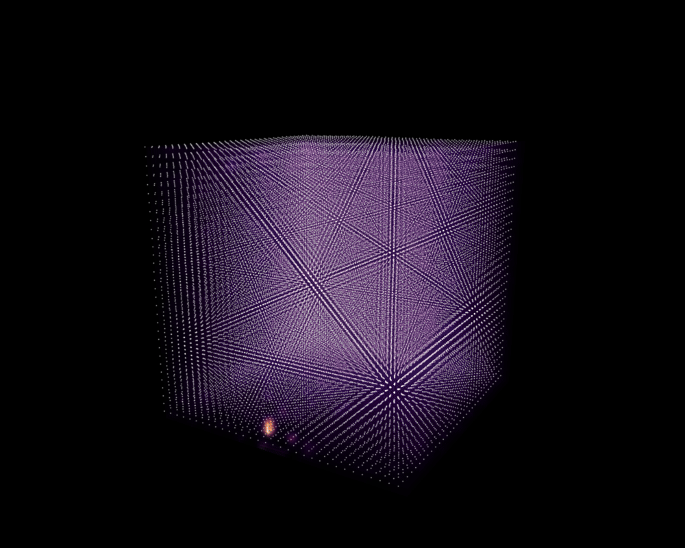

# Cosmological Code

This repository contains a TreePM/MFM cosmological code written in C++, along with documentation that explains the underlying physics and algorithms.

## Key Features

* **Gravity Solvers:**
    * **TreePM Gravity:** Fourier-Split solver combining an FFT-based Particle-Mesh (PM) for efficient long-range forces with a Linear Bounding Volume Hierarchy (LBVH) tree for accurate short-range interactions.
* **Cosmology:**
    * **Integration:** Supports generalized flat $\Lambda\text{CDM}$ cosmologies (including Einstein-de Sitter) using a Kick-Drift-Kick (KDK) scheme.
    * **Initial Conditions:** Includes native generation of initial conditions via the Zel'dovich Approximation and the BBKS transfer function.
* **Hydrodynamics:**
    * **Dual Solvers (Eulerian & MFM):** Offers the choice between a fixed-grid **Eulerian** finite-volume solver and a Lagrangian **Meshless Finite Mass (MFM)** particle-based solver.
    * **HLLC and exact Riemann Solvers:** Implements both the Harten-Lax-van Leer-Contact (HLLC) approximate solver and an exact Riemann solver to compute fluxes.
    * **Radiative Thermodynamics:** Features two modes: a baseline analytical model for primordial Bremsstrahlung cooling, and an advanced table-based model that incorporates metallicity-dependent cooling and cosmic ultraviolet background (UVB) heating. The code uses the Dual Energy Formalism to avoid internal energy corruption. 
* **High-Performance Computing (HPC):**
    * **OpenMP Multithreading and SIMD Vectorization:** The code is parallelized across available CPU cores and leverages AVX vectorization.
    * **GPU Offloading:** Gravity can be offloaded to GPUs and executed in parallel with the CPU's hydro computations.
* **Configuration & I/O:**
    * **Parameter Input:** Configuration parameters are read at runtime from a plain-text `ini` file.
    * **Snapshot Output:** Snapshots are saved periodically using the HDF5 (Hierarchical Data Format) file format.
    * **Diagnostics:** Real-time logging of diagnostic metrics to stdout and CSV.
    


## Repository Structure

* [`/src/`](src/): A C++ TreePM + hydrodynamics cosmological code.
* [`/docs/`](docs/): Contains a "living book" titled **"Notes on Cosmological Simulations"** in Markdown format. It includes a `Makefile` to automatically build the source notes into EPUB and PDF files.
* [`/scripts/`](scripts/): Contains Python utilities for post-processing, including a dashboard (`dashboard.py`) to plot and diagnose physics from the HDF5 outputs.

## Getting Started

### C++ Cosmological Code
This section refers to the ASIMOV (Advanced Simulation of Intergalactic Matter and Observable Voids) code.

1. **Prerequisites (Linux/Ubuntu):**
You need a C++ compiler, CMake, and the development libraries for FFTW3, HDF5, Eigen, and OpenMP. To use GPU offloading, the NVIDIA HPC SDK (`nvc++`) is recommended.
```bash
sudo apt update
sudo apt install build-essential cmake libhdf5-dev libeigen3-dev libomp-dev libfftw3-dev

# Optional: For GPU offloading, install the NVIDIA HPC SDK.
# See NVIDIA's documentation for installation instructions.

```


2. **Compile (with CMake):**
This project uses CMake to find dependencies, download testing frameworks, and build the executables. You can build the project for GPU offloading or standard CPU execution.

**Option A: GPU Offload Build (Recommended with NVIDIA HPC SDK)**
```bash
mkdir build && cd build

# Force CMake to use nvc++ and enable the GPU offload toggle
CXX=nvc++ cmake -DUSE_GPU_OFFLOAD=ON ..

make -j

```

**Option B: Only CPU Build**
```bash
mkdir build && cd build
cmake -DUSE_GPU_OFFLOAD=OFF ..
make -j

```

This will create two executables inside the `build` directory: the main simulation `asimov` and the automated test suite `run_tests`.

3.  **Download Simulation Data (Optional):**
Before running the simulation, you can download the base glass files for initial conditions (provided by the SWIFT project) and the UV background cooling tables (from the Grackle project). From the repository root, execute the included fetch script:

```bash
cd data
chmod +x fetch_data.sh
./fetch_data.sh
cd ..
```

4.  **Run:**
The build process automatically copies the `config.ini` file into the `build` directory. You can run the simulation from there:

```bash
# From inside the 'build' directory:
./asimov
```

The program will start and automatically load its configuration from `config.ini` and create a uniquely timestamped folder inside the configured output directory to store all snapshots and diagnostics.

5.  **Run the automated tests:**
To ensure the physics engine and mathematical utilities are functioning correctly on your machine, you can run the built-in test suite:
```bash
# From inside the 'build' directory:
ctest --output-on-failure
```

### Post processing scripts
The `dashboard.py` script generates a visual diagnostic suite. It tracks the macroscopic state of the simulation, including cosmic expansion, structure growth, energy conservation, and thermodynamic phase diagrams. There are other scripts specifically for validating other kinds of simulations like Sod Shock Tube or Sedov Blaswave tests that work in the same way.

1.  **Prerequisites:** Requires `matplotlib` and `camb` in addition to `numpy` and `h5py`.
    ```bash
    pip install matplotlib camb
    ```
    The viewer script requires as well vispy, pyqt5, PyOpenGL and h5py

2.  **Run:** Navigate to your project root and execute the script, passing the directory containing your `.hdf5` snapshots as an argument:
    ```bash
    python scripts/dashboard.py build/outputs/timestamped_folder/
    ```
    This will open a window displaying the physical metrics of the run.


### Building the Book (Documentation)
The `/docs` folder contains a guide detailing the physics and algorithms used in this project. The Markdown source can be compiled into EPUB and PDF documents.

1.  **Prerequisites:** Pandoc and a LaTeX distribution are required to generate the PDF.
    ```bash
    sudo apt update
    sudo apt install pandoc texlive-latex-base texlive-latex-extra
    ```
2.  **Build:** Navigate to the `docs` directory and use the provided `Makefile`.
    ```bash
    cd docs
    make        # Builds both EPUB and PDF
    
    # Or build them individually:
    make pdf
    make epub
    ```

## Configuration Parameters

The simulation is configured using a standard INI file format. Below is a breakdown of all available parameters by section.

### `[domain]`

Defines the spatial properties and resolution of the simulation box.

* **`domain_size`**: The internal code-unit length of the box (typically set to `1.0` for natural units).
* **`mesh_size_1d`**: The number of grid cells along one axis for the Poisson solver and hydrodynamics, if using the eulerian method (e.g., `32` creates a 32x32x32 computational grid).
* **`num_particles_1d`**: The number of N-body particles along one axis (e.g., `32` creates 32,768 total particles). Often matched to `mesh_size` to avoid interpolation artifacts.
* **`num_gas_particles_1d`**: The number of gas particles along one axis, when using MFM for hydrodynamics.
* **`box_size_mpc`**: The physical comoving size of the simulation box in Megaparsecs (Mpc). Used to map internal code units back to physical reality.

### `[cosmology]`

Defines the cosmological model of the universe.

* **`omega_baryon`**: The density parameter for normal (baryonic) matter.
* **`omega_M`**: The total matter density parameter (baryons + dark matter). Dark energy is dynamically assumed to be `1.0 - omega_M` for a flat universe.
* **`omega_lambda`**: The dark energy density parameter (cosmological constant).
* **`Hubble_h`**: The dimensionless physical Hubble parameter (*h*), where H0 = 100 * h km/s/Mpc.
* **`spectral_index`**: The primordial power spectrum index (*n_s*), typically `0.96` based on Planck data.
* **`sigma_8`**: The normalization of the power spectrum, defining the amplitude of density fluctuations at an 8 Mpc/h scale.
* **`expanding_universe`**: Boolean (`true` or `false`). If true, the code applies Hubble drag and stretches the comoving grid over time.

### `[gravity]`

* **`comoving_softening_factor`**: The gravitational softening length as a multiplier of the mean inter-particle spacing.
* **`softening_cap_scale_factor`**: The expansion scale factor at which the physical size of the softening length is capped (so that its physical size won't grow more). This may be needed to preserve halo density through the simulation.
* **`use_pm`**: Boolean. Enables the long-range Particle-Mesh (PM) force calculation via Fast Fourier Transform.
* **`use_pp`**: Boolean. Enables the short-range Particle-Particle (PP) direct summation for sub-grid resolution.
* **`pm_smoothing_cells`**: The scale ($r_s$) of the Fourier-space Gaussian filter, defined in units of grid cells. Determines how smoothly the grid force is blunted to avoid anisotropic grid artifacts. Minimum sound value is 1.0.
* **`cutoff_radius_factor`**: A multiplier that defines the cutoff radius relative to the smoothing scale ($r_c = \text{factor} \times r_s$). Because the short-range force is an erfc exponential decay, the cutoff must be placed far enough out to avoid force discontinuity. Typically set to at least 3.5.

### `[initial_conditions]`

Controls the generation of the primordial density field and particle distributions.

* **`setup`**: Initial configuration for gas and DM. Can be "cosmological" for a normal simulation, but also "sound_wave", "sod_shock_tube", "adiabatic_expansion" or "sedov_blastwave" to create initial conditions for these specific tests. In these cases, gravity and DM will be automatically disabled and expansion adjusted according to the specific test.
* **`use_glass`**: Will use glass files to generate the initial conditions when available. These must be located in the configured `glass_folder_path` and can be downloaded [`here`](https://virgodb.cosma.dur.ac.uk/swift-webstorage/ICs/) or through the `fetch_data.sh` script found in the `data` folder.
* **`glass_folder_path`**: The folder where the glass files are located.
* **`initial_gas_temp_k`**: The physical temperature of the baryonic gas at `start_a`, in Kelvin.
* **`seed_metallicity_solar`**: The initial uniform metallicity mass fraction (Z) of the gas, expressed as a ratio to the present-day solar metallicity ($Z\odot$). Typically set to 0.0.
* **`fixed_ics`**: Boolean. If `true`, the Zeldovich field is generated with the exact theoretical power amplitude (while keeping random phases). If false, it defaults to traditional Gaussian random amplitudes and phases.
* **`invert_phases`**: Boolean. If `true`, the random phases are inverted when generating the Zeldovich field. Running paired simulations with `fixed_ics = true` and inverted phases eliminates in-box cosmic variance.
* **`seed`**: Integer seed for the random number generator, ensuring reproducible initial density fields.

### `[hydro]`

Configures the fluid dynamics solver for the baryonic gas.

* **`hydro_method`**: The method used for hydrodynamics. It can be "none", "eulerian" or "mfm".
* **`gamma`**: The adiabatic index (ratio of specific heats) of the gas. Set to `1.6666666667` (5/3) for a monatomic, non-relativistic ideal gas.
* **`enable_cooling`**: Boolean. If `true`, the code activates the implicit radiative cooling solver to extract thermal energy from the gas over time.
* **`primordial_mu`**: The mean molecular weight of the gas (e.g., `1.22` for neutral primordial hydrogen/helium gas). Used to accurately map internal energy to physical temperatures.
* **`temp_floor_k`**: The minimum temperature (in Kelvin) the gas is allowed to reach. Note that internally, the radiative cooling module halts at `cooling_cutoff_k` regardless, but this parameter acts as the ultimate floor for the hydrodynamics engine.
* **`cooling_cutoff_k`**: The minimum temperature (in Kelvin) at which the gas is allowed to radiate via the analytical radiative cooling. This parameter is ignored if a cooling table is provided.
* **`cooling_table_path`**: The file path to a pre-computed HDF5 cooling table (such as the HM2012 tables provided by Grackle) to compute metallicity-dependent cooling and UVB heating. When a table is provided, the analytical `cooling_cutoff_k` is overridden, and the code instead dynamically halts cooling at the configured `temp_floor_k`. The code has been tested with the Grackle data files (`CloudyData_UVB=HM2012.h5` is recommended), which can be found [here](https://github.com/grackle-project/grackle_data_files/tree/928696482fbe15d9bac4382de6134d95568f099c/input) or downloaded using the `fetch_data.sh` script found in the `data` folder.

### `[mfm]`

* **`mfm_target_neighbors`**: The desired effective number of interacting particles enclosed within the smoothing kernel of each gas particle (typically 32).
* **`mfm_neighbor_tolerance`**: The acceptable deviation from the target number of neighbors (e.g., 0.1). A tighter tolerance improves accuracy but may require more iterations.
* **`mfm_max_iterations`**: The maximum number of Newton-Raphson iterations the solver is allowed to perform when dynamically adjusting a particle's smoothing length to hit the target number of neighbors.
* **`dual_energy_threshold`**: Threshold to activate the dual energy formalism. If the internal energy falls below this fraction of the kinetic energy, the fallback is triggered.
* **`use_exact_riemann`**: Use an exact Riemann solver instead of the default HLLC.

### `[subgrid]`

Configures the subgrid models.

* **`enable_subgrid_clumping`**: Enables the cooling subgrid model. If enabled, the code applies a density-dependent clumping factor to scale the radiative cooling rate, compensating for unresolved high-density gas on coarse grids.
* **`subgrid_clumping_amplitude`**: The amplitude for the subgrid cooling factor. Set to -1 to let the simulation auto-calculate this based on the grid resolution.

### `[time]`

Controls the adaptive timestepping and integration limits.

* **`max_dt_dynamical_factor`**: Acts as a safety ceiling. Multiplied by the dynamical time, it defines the absolute maximum allowed timestep.
* **`gravity_accuracy_eta`**: The accuracy tolerance for the gravitational timestep. Smaller values yield more accurate particle orbits but require more integration steps.
* **`cfl_safety_factor`**: The Courant-Friedrichs-Lewy (CFL) number. Restricts the hydrodynamics timestep to ensure information does not travel further than one grid cell per step (must be < 1.0, typically `0.3`).
* **`a_start`**: The scale factor at which the simulation begins (e.g., `0.02` corresponds to redshift z = 49).
* **`a_end`**: The scale factor at which the simulation terminates. Set to `1.0` to run up to the present day (z = 0).
* **`individual_particle_time`**: Only when using MFM. Enables individual particle timesteps for gas and dark matter. Particles are binned into a synchronized power-of-two time hierarchy based on their local physics. If disabled, the entire simulation advances on the global macro-step.

### `[output]`

Manages how and when the simulation writes data to disk.

* **`save_hdf5_every_delta_a`**: The interval for writing full snapshot files (particles, mesh densities, velocities) to disk. This value is measured in scale factor increments for cosmological runs, or in standard simulation time units for non-expanding scenarios.
* **`debug_info_every_seconds`**: The frequency (in seconds) at which the code prints its current status, timestep, and performance metrics to the console/log.
* **`outputs_folder_path`**: The base directory for all simulation results. Each execution automatically generates a uniquely timestamped subfolder within this path to store its specific snapshots and diagnostic data.

### `[HPC]`

High-Performance Computing (HPC) and hardware execution settings.

* **`num_threads`**: The maximum number of OpenMP threads to spawn. If set to `0`, the simulation will defer to the terminal's `OMP_NUM_THREADS` environment variable, or default to all available CPU cores.

## HDF5 Snapshot Format & Units

The code exports simulation data using the HDF5 format. Almost all arrays are exported in raw **comoving code units**.

It is the responsibility of the post-processing tools (like the included Python dashboard) to use the scale factor ($a$) and the conversion multipliers in the file header to map these arrays back to physical reality.

Every snapshot contains the following internal structure:

### Metadata Subgroups (`/Header`, `/Config`, `/Units`)

To keep the snapshots organized, all metadata attributes are divided into three subgroups:

**1. `/Header`**
This group contains the global state of the simulation for the current snapshot:

* **`scale_factor`**: The current scale factor $a$ of the universe.
* **`simulation_time`**: The current physical time elapsed (in code units).

**2. `/Config`**
This group contains a complete dump of the `config.ini` configuration used to run the simulation, guaranteeing that every snapshot is fully self-describing. The attribute names here mirror the keys in the INI file (e.g., `mesh_size`, `omega_M`, `use_hydro`).

**3. `/Units`**
This group contains the physical unit conversion multipliers:

* **`unit_length_in_mpc`**: Multiplier to convert code length to comoving Megaparsecs.
* **`unit_time_in_gyr`**: Multiplier to convert code time to Gigayears.
* **`unit_velocity_in_kms`** / **`unit_velocity_in_cgs`**: Multipliers for peculiar velocity.
* **`unit_mass_in_msun`**: Multiplier to convert code mass to Solar Masses.
* **`unit_density_in_cgs`**: Multiplier to convert the raw code density to comoving CGS density ($\text{g/cm}^3$). To calculate the true physical density, you must multiply the code density by this factor, and then divide the result by $a^3$.
* **`factor_u_to_t`**: Multiplier to convert the specific internal energy ($U$) of the gas in code units directly into Physical Temperature in Kelvin. This bundles the mean molecular weight ($\mu$), adiabatic index ($\gamma$), and Boltzmann constant into a single convenient factor. *(Note: To get specific internal energy $U$ from the HDF5 file, you must take the `energy` array, subtract the kinetic energy, and divide by the `density` array).*

### Dark Matter Particles (`/Particles`)

This group contains flat 1D arrays for all N-body dark matter particles.

* **`position_[x,y,z]`**: Comoving spatial coordinates. Bound between `[0, domain_size]`. To get the true physical distance, apply the conversion factors and scale by $a$.
* **`velocity_[x,y,z]`**: Peculiar velocities in code units. To get physical peculiar velocities, apply the conversion factors and scale by $a$.
* **`acceleration_[x,y,z]`**: Gravitational acceleration in code units.
* **`mass`**: Particle mass in code units.

### Baryonic Gas (`/Gas`)

If hydrodynamics is enabled (`hydro_method` is not `none`), this group contains the fluid state of the simulation. The specific datasets written to this group depend on whether the Eulerian or MFM solver is used.

**Shared Group Attributes:**
Regardless of the active hydro solver, the group contains the following energy tracking attributes:

* **`cumulative_radiated_energy`**: *(Only present if `enable_cooling = true`)*. The total, integrated energy radiated away by the gas up to the current snapshot in code units. To convert this value to true physical energy (Ergs), multiply it by the physical energy unit conversion factor and by $a^2$.
* **`cumulative_photoheating_energy`**: *(Only present if `enable_cooling = true`)*. The total, integrated thermal energy injected into the gas by the cosmic ultraviolet background up to the current snapshot in code units. To convert to true physical energy (Ergs), multiply by the physical energy unit conversion factor and by $a^2$.
* **`cumulative_gravitational_work`**: The total, integrated kinetic energy injected into the gas by the gravitational field up to the current snapshot in code units. To convert this value to true physical energy (Ergs), multiply it by the physical energy unit conversion factor and by $a^2$.
* **`cumulative_expansion_work`**: The total, integrated $P dV$ thermodynamic work performed by the gas against the expanding cosmic metric up to the current snapshot in code units. To convert this value to true physical energy (Ergs), multiply it by the physical energy unit conversion factor and by $a^2$.

#### Eulerian Mesh Datasets (`hydro_method = "eulerian"`)

If the Eulerian solver is used, the data is exported as 3D grids flattened into 1D arrays in row-major order:

* **`density`**: The *comoving* mass density. Because the physical volume of the grid cells expands with the universe, to calculate the true physical density, you must multiply this array by the physical mass/volume unit conversions and **divide by $a^3$**.
* **`momentum_[x,y,z]`**: Comoving momentum density.
* **`energy`**: The total comoving energy density (Kinetic + Internal). To convert this grid to true physical energy, you must apply the conversion factors and **divide by $a$**.
* **`pressure`**: Comoving thermal pressure. It must be divided by $a$ to reflect physical pressure.
* **`temperature`**: Unlike the other grids, the simulation engine explicitly converts the internal energy of the gas into **Physical Kelvin** before writing this array to disk. No scale factor corrections are needed for this dataset.
* **`metal_density`**: The *comoving* mass density of heavy elements (metals). Like the main gas density, converting this to a true physical density requires applying the mass/volume unit conversions and **dividing by $a^3$**. *(Note: To calculate the dimensionless metallicity fraction, $Z$, for data analysis, you can divide this array by the `density` array, as the comoving scale factors cancel out).*
* **`thermal_timescale`**: The time, in code units, required for a cell to radiate all its heat at the current rate (if negative), or to double its current internal energy (if positive).

#### MFM Particle Datasets (`hydro_method = "mfm"`)

If the Meshless Finite Mass (MFM) solver is used, the data is exported as 1D arrays where each index corresponds to a specific gas particle:

* **`position_[x,y,z]`**: The comoving coordinates of the gas particles.
* **`velocity_[x,y,z]`**: The comoving velocities (peculiar velocities) of the gas particles.
* **`acceleration_[x,y,z]`**: The total comoving accelerations experienced by the particles.
* **`mass`**: The mass of each gas particle.
* **`smoothing_length`**: The adaptive kernel radius ($h$) for each particle.
* **`density`**: The *comoving* mass density computed at the particle's location. Apply volume conversions and **divide by $a^3$** for physical density.
* **`pressure`**: Comoving thermal pressure. Must be divided by $a$ for physical pressure.
* **`internal_energy`**: The specific comoving internal energy (energy per unit mass, $u$) of the particle. Multiply this array by $a^2$ to recover physical specific internal energy.
* **`metal_fraction`**: Unlike the Eulerian solver which tracks metal density, MFM directly tracks the dimensionless mass fraction of metals ($Z$). No conversions are needed.
* **`temperature`**: Converted internally and written directly in **Physical Kelvin**. No scale factor corrections are required.
